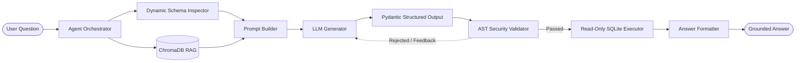

# Text-to-SQL AI Agent with Continuous Self-Verification

A research-ready, secure, and production-grade **Text-to-SQL AI Agent** built in Python 3.11+. The system translates natural-language business questions into safe ANSI SQLite queries, executes them against an enforced read-only database, and delivers clear, grounded explanations.

Developed with a strict engineering hierarchy:
$$\text{Correctness} \rightarrow \text{Security} \rightarrow \text{Reproducibility} \rightarrow \text{Documentation} \rightarrow \text{User Experience}$$

---

## Features

- **Dynamic Schema Inspection**: Live introspection of table schemas, column types, primary keys, and foreign keys directly from SQLite catalog metadata.
- **Semantic Context & Few-Shot RAG**: ChromaDB vector store indexing table semantic descriptions and question-to-SQL exemplars.
- **Pluggable Embedding & LLM Providers**: Built-in support for Ollama (`nomic-embed-text`), cloud LLMs (OpenAI, Gemini), and a deterministic offline test provider for 100% reproducible testing.
- **Structured Generation**: Pydantic data models enforcing clean separation between executable SQL, bound parameters, and contextual assumptions.
- **Multi-Layered AST Security**: `sqlglot`-driven AST validation that enforces a strict `SELECT`-only policy, restricts tables and columns to an approved allowlist, and rejects DDL, DML, file attachments, and comment evasion techniques.
- **Enforced Read-Only Execution**: Multi-boundary isolation leveraging SQLite URI read-only mode (`file:...mode=ro`), query timeouts via progress handlers, and row-count limits.
- **Self-Healing Agent**: Automatic error-diagnostic feedback loop that permits the agent to self-correct generated queries if validation or execution fails.
- **Interactive UI & CLI**: User-friendly Streamlit web interface and terminal CLI.

---

## Architecture Overview



Detailed design and trade-offs are documented in [decision.md](file:///Users/astitva/Desktop/sem5/decision.md).
Step-by-step setup and operational guides are documented in [implementation.md](file:///Users/astitva/Desktop/sem5/implementation.md).

---

## Quickstart

### 1. Setup Virtual Environment
```bash
/opt/homebrew/bin/python3.11 -m venv .venv
source .venv/bin/activate
pip install -r requirements.txt
```

### 2. Configuration
```bash
cp .env.example .env
# Edit .env if using Ollama or Cloud API keys
```

### 3. Initialize Database & Seed Records
```bash
.venv/bin/python -c "from database import init_database; init_database('business.db')"
```

### 4. Index ChromaDB Vector Store
```bash
.venv/bin/python -c "from retriever import index_all_context; index_all_context()"
```

### 5. Run QueryPilot AI Modern Frontend (React + Vite)
```bash
# Terminal 1: Launch FastAPI REST API Backend
.venv/bin/uvicorn api_server:app --port 8000 --reload

# Terminal 2: Launch Vite Development Server
cd frontend
npm install
npm run dev
# Open http://localhost:5173 in your browser
```

### 6. Legacy Interfaces (Streamlit & CLI)
```bash
# Launch Streamlit Web UI
.venv/bin/streamlit run app.py

# Or run via CLI
.venv/bin/python app.py --cli "How many orders were placed in October 2026?"
```

---

## Automated Testing

```bash
# Run all unit, integration, and security tests
.venv/bin/pytest -v

# Run evaluation benchmark
.venv/bin/pytest -v tests/test_evaluation.py
```

---

## Documentation Links

- [Authoritative Engineering Decision Record](file:///Users/astitva/Desktop/sem5/decision.md)
- [Comprehensive Implementation Guide](file:///Users/astitva/Desktop/sem5/implementation.md)
- [Chronological Implementation Audit Log](file:///Users/astitva/Desktop/sem5/IMPLEMENTATION_LOG.md)
